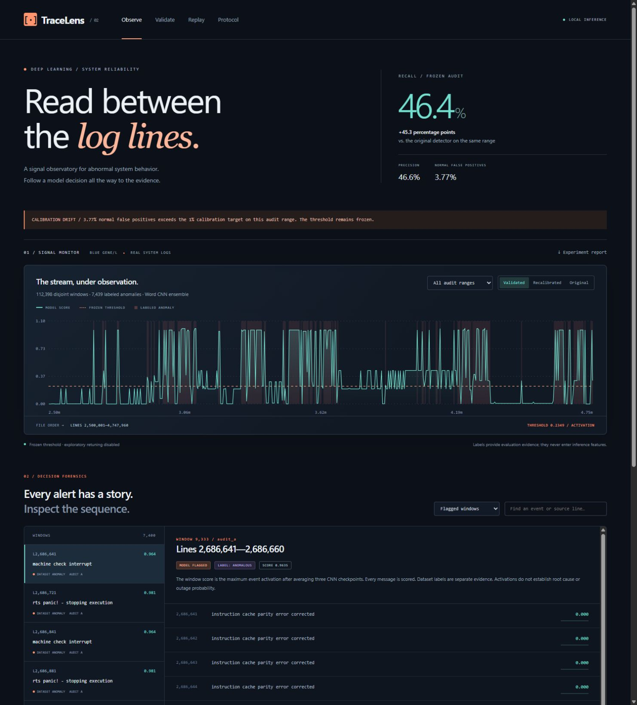

# TraceLens — Signal observatory

**Deep learning for system-log anomalies, with calibration drift left visible.**

TraceLens connects neural modeling to an engineering question: can a detector find more abnormal behavior without hiding the false-alarm cost? It pairs reproducible PyTorch experiments with a distinctive signal-analysis interface, incident rail, event inspector, and real local checkpoint inference.

[GitHub repository](https://github.com/bryanbans/tracelens) · [Review findings and next experiments](docs/REVIEW.md)

Inspired by D802 Deep Learning in a computer science master's program in AI/ML.



## What changed in v2

- A word-level CNN learns shared message phrases instead of treating every unfamiliar event template as one unknown identity.
- Three seeded CNNs average per-event activations, with max pooling across each window.
- Development selection, deployment calibration, and three subsequent audit ranges are disjoint.
- A frozen plan hashes data, checkpoints, vocabulary, scoring code, and thresholds before audit inference.
- A controlled comparator recalibrates the original LSTM without changing its representation/model.
- The UI replaces the sidebar/card dashboard with horizontal navigation, editorial typography, an instrument-style trace canvas, and linked incident evidence.

## Review refinements (v0.2.1)

Replay shows word coverage and truncation, preserves source line numbers, and withholds decisions for unsupported windows. Frozen audit thresholds cannot be overridden through the API. Integrity checks and 40 regression tests cover the release. A post-hoc bootstrap sensitivity analysis retains positive recall-difference intervals across four block lengths in every range; false-positive increases persist too. [Read the review](docs/REVIEW.md).

The current comparison does not establish superiority over a similarly supervised lexical baseline. Further detector selection needs new evaluation data. LinkedIn publication is on hold while the project is refined; GitHub comes first.

## Results on identical audit windows

112,398 windows from later BGL records; 7,439 labeled anomalous and 104,959 normal. These are different time ranges from v1's inspected test, so compare the methods below with each other, not v2 AP with v1 AP.

| Detector | Recall | Precision | Normal FPR | Average precision |
| --- | ---: | ---: | ---: | ---: |
| Original frozen LSTM | 1.01% | 81.52% | 0.0162% | 0.1035 |
| Original LSTM, recalibration only | 12.84% | 9.07% | 9.124% | 0.1035 |
| Word CNN ensemble + calibration | 46.35% | 46.59% | 3.765% | 0.3407 |

Recall improves in all three audit ranges. On the final confirmation range, the CNN achieves **74.22% recall, 69.21% precision, and 2.89% normal FPR**. Paired 250-window moving-block bootstrap intervals for recall gain are positive in each range.

**The 1% calibration false-positive target did not transfer over time.** The app shows that failure prominently. Increased recall costs additional false alarms; this is an audited research detector, not a production reliability guarantee. See [the full calibration audit](docs/CALIBRATION_AUDIT.md), including every time range and the prior archive-wide label-count inspection disclosure.

## Run locally

Python 3.11+; verified on Python 3.12 / Windows / CPU PyTorch. No cloud model API, GPU, or frontend build is required. Trained checkpoints and derived evaluation artifacts are bundled.

On Windows, run `Launch TraceLens.cmd` to create/install a project-local environment on first launch. Or use:

```powershell
python -m venv .venv
.venv\Scripts\Activate.ps1
python -m pip install torch --index-url https://download.pytorch.org/whl/cpu
python -m pip install -e ".[dev]"
tracelens serve
```

On macOS/Linux, activate with `source .venv/bin/activate`. Open **http://127.0.0.1:8765** and keep the server running. The default serves `artifacts/validated`; `tracelens serve --artifacts artifacts/portfolio` opens the preserved v1 app/results. The exact verified environment is recorded in `requirements-lock.txt` (Windows CPU wheel resolution may differ elsewhere).

## Reproduce and verify

```powershell
tracelens download --output data/BGL.zip
# Optional: refit content CNNs. This explicit flag replaces artifacts/semantic;
# frozen release checkpoints in artifacts/validated stay separate.
python scripts/train_semantic.py --data data/BGL.zip --overwrite
python -m tracelens.audit develop --data data/BGL.zip --output artifacts/reproduced-audit
# Inspect the freeze before opening audit predictions:
python -m tracelens.audit audit --data data/BGL.zip --output artifacts/reproduced-audit
python scripts/compact_audit.py --artifacts artifacts/reproduced-audit
python -m pytest -q
node --check tracelens/web/v2.js
```

The source BGL archive is approximately 57.5 MB compressed. Raw logs are not bundled. Checkpoints, the frozen procedure, archive hash, all audit scores, paired intervals, and confusion matrices are retained. The release packs templates and exact numerical scores in `traces.json.gz`; packing does not alter evaluation decisions. `scripts/compact_audit.py` reproduces the release packing for the default validated directory from its raw audit export.

The audit command verifies frozen hashes before scoring and refuses an in-place repeat after a report exists. A separate output directory makes reproduction explicit. Subsequent tuning needs new holdouts; these audited ranges are now inspected.

## Deep learning evidence

- Learned embeddings; recurrent LSTM state; causal dilated residual convolutions; word-level phrase convolutions; GELU; token and event max pooling.
- Minibatch backpropagation, AdamW, weight decay, dropout, clipped gradients, seeded training, and held-out epoch selection.
- Event-frequency baselines, three-seed sequence experiments, order/dropout ablations, supervised content modeling, calibration policy selection, and paired temporal evaluation.
- Tests for causality, label exclusion, train-only vocabulary, split separation, a finite-difference gradient check, strict/tied thresholds, budget optimization, packed artifact integrity, and live inference parity.

## Source map

```text
tracelens/
  models.py          # original LSTM / causal temporal CNN
  semantic.py        # word-level content CNN and fitting
  calibration.py     # scoring rules, budgeted thresholds, paired bootstrap
  audit.py           # development freeze, then separate temporal audit
  api.py             # packed artifacts and real ensemble inference
  web/v2.*           # signal observatory UI
artifacts/
  portfolio/         # original experiments, preserved
  semantic/          # three content-CNN checkpoints and training histories
  development-v2/    # initial sequence-only development freeze, never audited
  validated/         # final frozen detector and audit evidence
configs/validation-v2.json
tests/
docs/
```

## Reading and portfolio material

- [Calibration audit and measured v2 findings](docs/CALIBRATION_AUDIT.md)
- [Current model card](docs/MODEL_CARD.md)
- [v2 specification](docs/SPEC_V2.md)
- [Deep learning mechanics](docs/DEEP_LEARNING_NOTES.md)
- [Release validation](docs/VALIDATION.md)
- [Historical LinkedIn draft — publication on hold](docs/LINKEDIN_POST.txt)
- [Historical v1 case study](docs/CASE_STUDY.md) and [v1 README](docs/README_V1.md)
- [Data attribution and terms](THIRD_PARTY_NOTICES.md)

## Limits

BGL is historical supercomputer data. File-order windows may mix nodes. Labels indicate retrospective alert messages, not future outages. The word model truncates events to 16 tokens; activations are not calibrated outage probabilities. Coarse class counts across the archive were previously inspected, so the new ranges are prediction-blind temporal audits, not pristine label-blind external replication. The 1% normal-FPR target was missed on every audit range. No audit-driven retuning was used to hide that result.

The app binds to loopback and processes input locally. Its inference form is for this learned domain; other log formats require their own training and validation. Project code is MIT licensed; BGL-derived artifacts retain Loghub's separate research/academic terms and attribution requirements.
