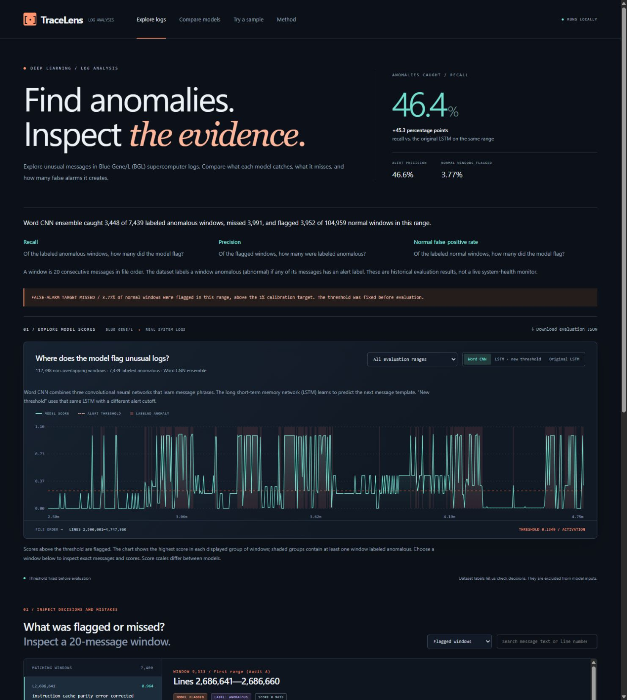

# TraceLens

**Find unusual system-log messages. Inspect the evidence. Measure the false alarms.**

TraceLens helps you find and investigate unusual system-log messages using deep learning. It groups messages into 20-message groups, called windows, scores each window, and flags those above a fixed alert threshold. You can inspect the messages, compare models, and see which windows the dataset marks as abnormal, which of those the model catches or misses, and which normal windows trigger false alarms.

The project asks a practical question: **can a model catch more abnormal messages without overwhelming the reviewer with false alarms as the logs change?**



## The problem

A system log can contain millions of repetitive messages with a small number of unusual events mixed in. Searching for an error keyword is a useful starting point, but it does not tell you how many relevant events you missed, how many alerts were false alarms, or whether a detector still works on later logs.

TraceLens brings detection, inspection, and evaluation into one workspace. It uses real logs from the Blue Gene/L (BGL) supercomputer to make those questions concrete. Its current scope is historical log analysis and model evaluation; applying it to another system requires training and validation for that system.

I started TraceLens while studying deep learning in graduate school. I wanted to understand how neural networks learn patterns in repetitive machine-generated text, and whether an alert threshold would still work when the logs changed.

## What questions does TraceLens answer?

| Question | How TraceLens helps |
| --- | --- |
| **Which groups of messages does the model flag?** | Browse scores over the log file and open the exact 20-message window behind a decision. |
| **Which messages received the strongest model response?** | Inspect message scores alongside the text. These show model responses, not proven causes. |
| **What did the detector miss, and which alerts were false?** | Use the dataset labels to find flagged windows, windows labeled abnormal that were missed, and false alarms. |
| **Does changing the model help more than changing the threshold alone?** | Compare a sequence model, that same model with a new alert threshold, and a model that learns message phrases on identical evaluation windows. |
| **Does a threshold keep working on later logs?** | Compare recall, precision, and false-positive rates across three later sections of the log. |
| **How does the trained model respond to a supplied sample?** | Paste or import messages and run the saved models on your machine. See which words they recognize and whether any messages were too long or could not be scored reliably. |

## Start exploring

Trained models and evaluation results are included, so you can explore the project without training a model first.

1. **Explore logs:** select a flagged window and inspect its messages. The bundled example includes routine error-correction messages followed by a machine-check interrupt. Compare the model response to each message; the scores alone do not explain the cause.
2. **Investigate mistakes:** switch to **Missed anomalies** or **False positives**. Compare the model's response with the dataset labels.
3. **Compare models:** compare the three detectors and see how performance changes across later log ranges.
4. **Try a sample:** load an example or import a sample and run the saved models locally. The app has no verified labels for pasted logs, so it can show model scores but cannot measure their accuracy.
5. **Method:** inspect the training boundaries, threshold selection, and recorded evaluation procedure.

## What the experiment found

The model that learns message phrases catches more labeled anomalies than the original sequence model on the same later log windows, but it also creates more false alarms. The phrase model is a **convolutional neural network (CNN)**; the original sequence model is a **long short-term memory network (LSTM)**. The CNN ensemble combines three separately trained networks.

The comparison covers **112,398 non-overlapping windows of 20 messages**, including **7,439 labeled anomalous windows**. A window is labeled anomalous if it contains at least one dataset-labeled abnormal message.

| Detector | Anomalous windows caught (recall) | Flagged windows that were anomalous (precision) | Normal windows incorrectly flagged |
| --- | ---: | ---: | ---: |
| Original LSTM | 1.01% | 81.52% | 0.0162% |
| Same LSTM, recalibrated threshold | 12.84% | 9.07% | 9.124% |
| Word CNN ensemble | 46.35% | 46.59% | 3.765% |

In counts, the CNN finds **3,448 of 7,439 anomalous windows**, misses **3,991**, and incorrectly flags **3,952 normal windows**. Its higher recall comes with a substantial review burden.

**When the threshold was set, fewer than 1% of normal windows were flagged. In every later evaluation range, the false-positive rate exceeded that 1% target.** TraceLens makes that change visible. This is the central finding: better detection on one measure does not by itself make a detector reliable enough to deploy.

The CNN catches more labeled anomalies in each of the three later ranges, with more false alarms too. Additional checks of the statistical uncertainty support that tradeoff. The [evaluation report](docs/CALIBRATION_AUDIT.md) and [review](docs/REVIEW.md) explain the methods, results for each range, and remaining uncertainties.

## How the models work

TraceLens compares two ways to learn from logs:

- **Sequence models:** an LSTM and a causal temporal CNN learn to predict the next event identity from normal training windows. An event identity represents a normalized message template, with variable values such as numbers replaced by placeholders. Unexpected events receive higher surprise scores.
- **Message-content model:** a word-level CNN learns phrase patterns using labeled training windows. Three models trained with different random seeds average their scores for each message. These message scores are called activations; the highest average becomes the window score. It can recognize familiar words within a new event template, but does not model the order of messages across a window.

Only message content enters the models. Alert-category labels, severity, timestamps, and node metadata are excluded from input features. Training, model selection, threshold calibration, and later evaluation use separate file ranges. Model weights and thresholds were fixed before opening the later evaluation predictions.

The [deep learning notes](docs/DEEP_LEARNING_NOTES.md) explain the computation graphs, objectives, and design tradeoffs.

## Run locally

Requires Python 3.11 or newer. Verified on Windows with Python 3.12 and CPU PyTorch. The trained models and saved results are included. You do not need a GPU, a cloud AI service, or a separate build step for the interface.

```shell
git clone https://github.com/bryanbans/tracelens.git
cd tracelens
```

On Windows, run `Launch TraceLens.cmd` to set up a Python environment and install dependencies on first launch. Or use:

```powershell
python -m venv .venv
.venv\Scripts\Activate.ps1
python -m pip install torch --index-url https://download.pytorch.org/whl/cpu
python -m pip install -e ".[dev]"
tracelens serve
```

On macOS/Linux, activate with `source .venv/bin/activate`. Open **http://127.0.0.1:8765** and keep the server running. The default serves `artifacts/validated`; `tracelens serve --artifacts artifacts/portfolio` opens the preserved v1 app/results. The exact verified environment is recorded in `requirements-lock.txt` (Windows CPU wheel resolution may differ elsewhere).

## Reproduce and verify

```powershell
tracelens download --output data/BGL.zip
# Optional: refit content CNNs. This explicit flag replaces artifacts/semantic;
# frozen release checkpoints in artifacts/validated stay separate.
python scripts/train_semantic.py --data data/BGL.zip --overwrite
python -m tracelens.audit develop --data data/BGL.zip --output artifacts/reproduced-audit
# Inspect the freeze before opening audit predictions:
python -m tracelens.audit audit --data data/BGL.zip --output artifacts/reproduced-audit
python scripts/compact_audit.py --artifacts artifacts/reproduced-audit
python -m pytest -q
node --check tracelens/web/v2.js
```

The source BGL archive is approximately 57.5 MB compressed. Raw logs are not bundled. Checkpoints, the frozen procedure, archive hash, all audit scores, paired intervals, and confusion matrices are retained. The release packs templates and exact numerical scores in `traces.json.gz`; packing does not alter evaluation decisions. `scripts/compact_audit.py` reproduces the release packing for the default validated directory from its raw audit export.

The audit command verifies frozen hashes before scoring and refuses an in-place repeat after a report exists. A separate output directory makes reproduction explicit. Further tuning needs new evaluation data. These ranges have already been examined.

## Technical skills demonstrated

- Learned embeddings; recurrent LSTM state; causal dilated residual convolutions; word-level phrase convolutions; GELU; token and event max pooling.
- Minibatch backpropagation, AdamW, weight decay, dropout, clipped gradients, seeded training, and held-out epoch selection.
- Event-frequency baselines, three-seed sequence experiments, order/dropout ablations, supervised content modeling, calibration policy selection, and paired temporal evaluation.
- Tests for causality, label exclusion, train-only vocabulary, split separation, a finite-difference gradient check, strict/tied thresholds, budget optimization, packed artifact integrity, and live inference parity.

## Where to find the code

```text
tracelens/
  models.py          # original LSTM / causal temporal CNN
  semantic.py        # word-level content CNN and fitting
  calibration.py     # scoring rules, budgeted thresholds, paired bootstrap
  audit.py           # development freeze, then separate temporal audit
  api.py             # packed artifacts and real ensemble inference
  web/v2.*           # current log analysis interface
artifacts/
  portfolio/         # original experiments, preserved
  semantic/          # three content-CNN checkpoints and training histories
  development-v2/    # initial sequence-only development freeze, never audited
  validated/         # final frozen detector and audit evidence
configs/validation-v2.json
tests/
docs/
```

## Further reading

- [Evaluation methods and results](docs/CALIBRATION_AUDIT.md)
- [Current model card](docs/MODEL_CARD.md)
- [Project specification](docs/SPEC_V2.md)
- [Deep learning mechanics](docs/DEEP_LEARNING_NOTES.md)
- [Release validation](docs/VALIDATION.md)
- [Review findings and next experiments](docs/REVIEW.md)
- [Demonstration guide](docs/PORTFOLIO.md)
- [Historical v1 case study](docs/CASE_STUDY.md) and [v1 README](docs/README_V1.md)
- [Data attribution and terms](THIRD_PARTY_NOTICES.md)

## What to keep in mind

The results come from one historical supercomputer dataset. Consecutive messages can come from different machines. Dataset labels identify abnormal messages that have already occurred; they do not establish that the model predicts future outages. The word model reads only the first 16 word tokens per message, and its scores are not outage probabilities.

Counts of normal and abnormal records across the archive were inspected before this evaluation. Later predictions were kept separate from model and threshold selection, but this was not an independent test on a new dataset. The threshold missed its 1% false-positive target in all three later ranges, and it was not adjusted to improve those results.

The CNN uses labeled training windows, while the original sequence models train on normal windows only. Several things change together: the information the model receives, its training objective and labels, the network design, and the alert threshold. A simple text classifier trained with the same labels is still needed to establish how much deep learning itself contributes. Further tuning needs new evaluation data.

The original evaluation record omitted a separate checksum—a file fingerprint—for the CNN word-to-number mapping. The retained mapping matches the training copy and is now covered by release checksums. Those later checks cannot prove that it was unchanged before evaluation. See the full disclosure in the [evaluation report](docs/CALIBRATION_AUDIT.md).

The app accepts connections from your own machine and processes input locally. Its sample-scoring form uses models trained on BGL logs; other log formats require their own training and validation. Project code is MIT licensed; BGL-derived artifacts retain Loghub's separate research/academic terms and attribution requirements.
