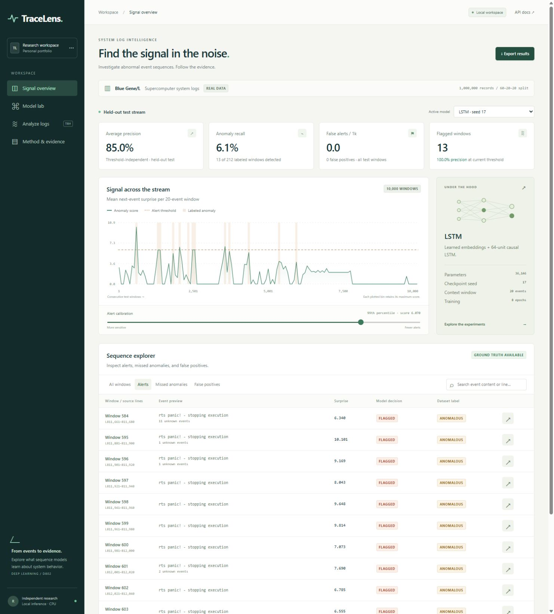

# TraceLens

**Deep learning for system-log anomaly detection — with the evidence left visible.**

TraceLens investigates a practical question: **does event order help neural networks distinguish abnormal behavior from simply rare messages?** It combines a reproducible PyTorch benchmark with an interactive incident explorer and real checkpoint inference.

Built as an independent portfolio project inspired by **D802: Deep Learning**, part of a computer science master's program in AI/ML.



## What you can explore

- A held-out test stream with model scores, labeled anomalies, and a validation-calibrated threshold.
- Searchable windows, alert/false-positive/missed-anomaly filters, and per-event surprise scores.
- An order-independent frequency baseline, an LSTM, and a residual causal temporal CNN.
- Shuffled-order and dropout ablations, each with three random seeds.
- Training curves, full experiment provenance, and local inference on pasted/uploaded logs.

## Measured results

The included experiment uses the **first 1,000,000 BGL records**, with a contiguous 60/20/20 split before disjoint 20-event windowing. The test set has 10,000 windows; 212 are labeled anomalous. This is a bounded dataset-prefix experiment, not a full-dataset benchmark.

| Experiment | Test average precision, mean ± sample SD |
| --- | ---: |
| Event-frequency baseline | 0.8031 (deterministic) |
| LSTM | 0.8556 ± 0.0062 |
| Temporal CNN | 0.8310 ± 0.0497 |
| LSTM, shuffled training order | 0.8506 ± 0.0052 |
| LSTM, no dropout | 0.8538 ± 0.0012 |

**Ranking is only part of the story.** The default checkpoint, selected by normal-validation loss, reaches AP 0.8500 but detects only 13/212 anomalous test windows at its frozen 99th-percentile normal-validation threshold. It has zero observed false positives on this particular test split. Across LSTM seeds, recall ranges from 1.4% to 66.0% despite similar AP. Test unknown-event frequency is 15.55%, versus 0.0125% on validation.

These results make threshold stability and distribution shift central findings. The small AP difference between ordered and shuffled training does **not** establish a substantial benefit from event order. See [the case study](CASE_STUDY.md) and the machine-readable [report](../artifacts/portfolio/report.json).

## Run the included application

Python 3.11+ is required; the verified environment used Python 3.12 on Windows with CPU PyTorch. No GPU, cloud account, frontend build, or external model API is required. The repository includes the trained checkpoints and derived evaluation artifacts.

On Windows, `Launch TraceLens.cmd` creates a project-local environment and installs the runtime on first launch. An internet connection is needed for that installation. The manual commands below are useful for development and testing.

```powershell
python -m venv .venv
.venv\Scripts\Activate.ps1
python -m pip install torch --index-url https://download.pytorch.org/whl/cpu
python -m pip install -e ".[dev]"
tracelens serve
```

On macOS/Linux, activate with `source .venv/bin/activate`; the remaining commands are the same. Open **http://127.0.0.1:8765**. The server binds to loopback. Keep the server running while using the application.

For the exact dependency versions captured for this build, install `requirements-lock.txt`, then `python -m pip install -e . --no-deps`. That lock captures the verified Windows CPU environment; other platforms may need platform-specific wheel resolution.

## Reproduce the experiment

The original BGL archive is approximately 57.5 MB compressed and is downloaded directly from the Loghub-linked Zenodo record. Raw logs are not bundled.

```powershell
tracelens download --output data/BGL.zip
tracelens train --data data/BGL.zip --config configs/portfolio.json --output artifacts/reproduced
tracelens serve --artifacts artifacts/reproduced
```

The saved run took about 129 seconds on the recorded host, before final artifact export; runtime varies by machine. Do not interpret it as a standardized throughput benchmark. The configuration, original archive SHA-256, environment, losses, gradients, thresholds, and all individual seed metrics are recorded in `report.json`.

Use a fresh output directory to preserve the included reference run. `--max-lines` can change the dataset prefix; pass `4747963` to process the full archive with this same pipeline, allowing for more RAM and training time. Larger-prefix/full-data results have **not** been measured for this release. Changing the prefix changes split boundaries and class balance, so results are not directly comparable.

## How it works

```mermaid
flowchart LR
    A[BGL source records] --> B[Split in file order 60 / 20 / 20]
    B --> C[Strip label and metadata; mask content]
    C --> D[Train-only event vocabulary]
    D --> E[Disjoint 20-event windows]
    E --> F[Normal-only model fitting]
    F --> G[Normal-validation checkpoint selection]
    G --> H[Normal-validation alert calibration]
    H --> I[Untouched test scoring and evidence explorer]
```



Models predict the next event from prior context. The score is the mean negative log likelihood of events 2–20. The first event supplies context and is not scored. High surprise indicates a mismatch with learned behavior; it is not a calibrated probability of failure or evidence of root cause.

Labels identify anomalous windows and filter normal training/calibration examples. They do not enter model features. This is a **semi-supervised normal-behavior fitting protocol**, not fully unlabeled learning. The vocabulary is fitted on all training content, while model weights and baseline counts use normal training windows only.

## Validation

```powershell
python -m pytest -q
node --check tracelens/web/app.js
```

Node is only needed for the optional JavaScript syntax check, not to run the app. Tests include future-token causality for both architectures, finite-difference verification of a backpropagated gradient, train-only vocabulary and split separation, label/metadata exclusion, idempotent parsing, threshold ties, and an end-to-end training/checkpoint/API round trip. Synthetic fixtures in tests are solely plumbing tests; the portfolio metrics come from the real BGL experiment.

## Project layout

```text
tracelens/
  data.py             # streaming input, masking, vocabulary, partitions
  models.py           # LSTM and causal residual temporal CNN
  train.py            # seeds, ablations, fitting, checkpoint export
  evaluation.py       # calibration, metrics, block bootstrap
  api.py              # saved evaluation and live inference
  web/                # accessible, responsive HTML/CSS/JavaScript app
configs/portfolio.json
artifacts/portfolio/  # real trained checkpoints and evaluation evidence
tests/
docs/                # case study, model card, launch copy, screenshots
SPEC.md
```

## Limits and next research steps

BGL comes from an older supercomputer and is not representative of every modern service. File-order windows can mix nodes; alert labels are not verified future outages. The bounded prefix has time-dependent class balance, and unseen templates can trigger alerts without failure. Imported logs must resemble the training domain for scores to be meaningful.

The current test set has been inspected during exploratory development. Further model/threshold tuning needs a new holdout or rolling-origin protocol. Next research steps are node/session-aware grouping, stronger template parsing, explicit open-set handling, evaluation across multiple untouched time splits, and replication on another system-log dataset.

## Documentation and attribution

- [Project specification and D802 mapping](../SPEC.md)
- [Technical case study](CASE_STUDY.md)
- [Deep learning mechanics and interview preparation](DEEP_LEARNING_NOTES.md)
- [Model card](MODEL_CARD.md)
- [Release validation](VALIDATION.md)
- [LinkedIn copy and demo script](PORTFOLIO.md)
- [Third-party data and references](../THIRD_PARTY_NOTICES.md)
- [Loghub / BGL](https://github.com/logpai/loghub/tree/master/BGL)

Project code is MIT licensed. BGL-derived artifacts retain the source dataset's research/academic terms and attribution requirements; the code license does not relicense the dataset.
